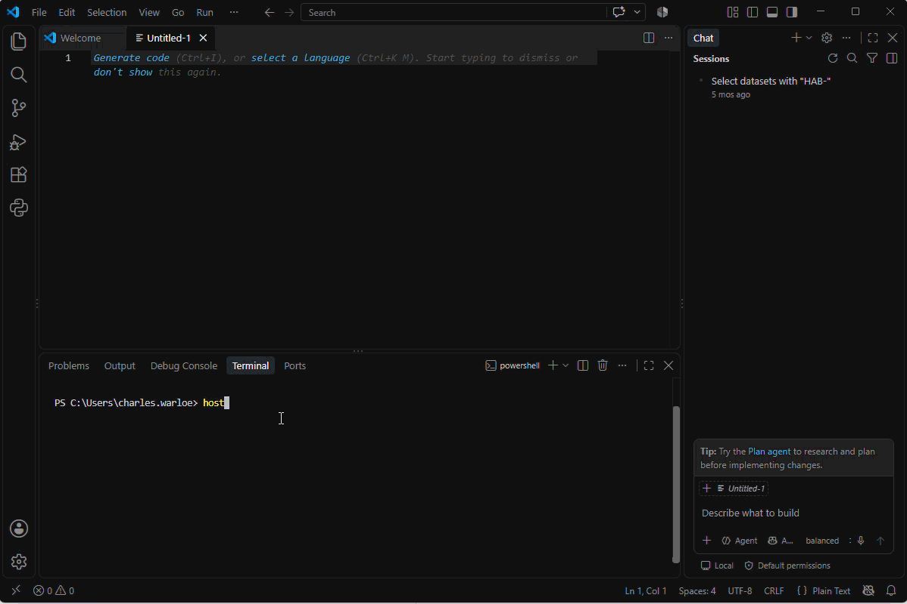

# VS Code Terminal Demo

This repository contains a short animated GIF demonstrating a Visual Studio Code workspace with:

- an untitled editor in the main workspace,
- the integrated PowerShell terminal open at the bottom,
- the Chat panel open on the right, and
- a command being entered at the PowerShell prompt.

The example shows how the editor, terminal, and AI/chat tools can remain visible together in one VS Code workspace.

## Demo

